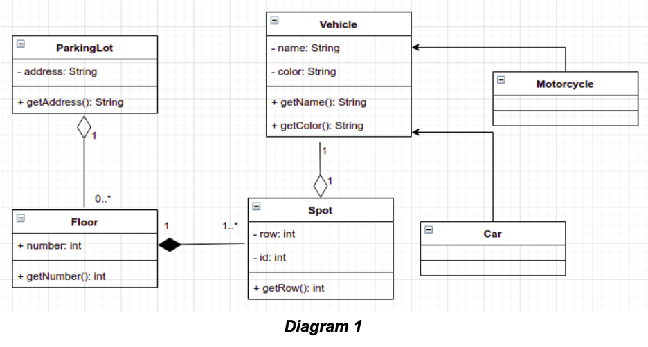

## Question 4: Multiple Choice Questions (MCQs) (25 marks)

Each MCQ has at least one correct option.

Marking for each MCQ:
- Correct (**ALL** selections correct): +1 mark
- Wrong (Not all selections correct, i.e., if any right options were not excluded and/or any wrong options were included): 0 mark
- Not attempted (left empty): 0 mark

*The score for the MCQs will be calculated as a percentage of the full marks
available, and will then be adjusted according to the weight assigned to
Question 4 in the exam.*

Please read the questions carefully, including whether you are required 
to select the CORRECT or INCORRECT options.

<br>

* * *

### Task

Complete the MCQs and enter your answer in `Q4Answers.txt`. The file must follow 
the dedicated format, and you should run `MCQAnswerSyntaxTest.java` to validate the format.

Example format (Only attempt questions 1, 2, and 4)
```
1. A,B
2. C
3.
4. D
```

<br>

***

#### Submission: commit and push your updates in the following files to the GitLab exam repository:
* `Q4Answers.txt`


***

### Multiple Choice Questions

### MCQ1

> Software Construction - select all that does NOT apply to complete the statement below.
> 
> Software Construction includes...

<ol type="A">
    <li class="A">coding</li>
    <li class="B">testing</li>
    <li class="C">debugging</li>
    <li class="D">modular design</li>
    <li class="E">problem definition</li>
    <li class="F">readability</li>
    <li class="G">planning</li>
    <li class="H">construction with reuse</li>
    <li class="I">use of standards</li>
    <li class="J">the use of integrated development environments</li>
    <li class="K">construction for reuse</li>
    <li class="L">use of profiling and performance analysis tools to support code tuning</li>
</ol>

* * *
<br>

### MCQ2

> How many branches are present in the following function?
> ```
>    public boolean checkAnswer(RiddleType type, String input) {
>        boolean isCorrect = false;
>
>        if (type == RiddleType.TEXT_RIDDLE) {
>            if (input.equalsIgnoreCase(answer)) {
>                isCorrect = true;
>            }
>        } else if (type == RiddleType.NUMERIC_RIDDLE) {
>            if (input.matches("\\d+") && Integer.parseInt(input) == Integer.parseInt(answer)) {
>                isCorrect = true;
>            }
>        } else if (type == RiddleType.ANAGRAM_RIDDLE) {
>            char[] inputChars = input.toLowerCase().toCharArray();
>            char[] answerChars = answer.toLowerCase().toCharArray();
>            Arrays.sort(inputChars);
>            Arrays.sort(answerChars);
>            if (Arrays.equals(inputChars, answerChars)) {
>                isCorrect = true;
>            }
>        }
>
>        if (isCorrect) {
>            isSolved = true;
>        }
>        return isCorrect;
>    }
>  ```

<ol type="A">
    <li class="A">10</li>
    <li class="B">11</li>
    <li class="C">12</li>
    <li class="D">14</li>
    <li class="E">15</li>
    <li class="F">16</li>
</ol>

* * *
<br>

### MCQ3

> How many distinct test inputs are necessary to ensure full branch coverage of 
  the `checkAnswer` function shown in MCQ2?

<ol type="A">
    <li class="A">5</li>
    <li class="B">6</li>
    <li class="C">7</li>
    <li class="D">8</li>
</ol>

* * *
<br>

### MCQ4

> Intellectual Property - Select all CORRECT statements considering the Australian context.

<ol type="A">
    <li class="A">Copyright is automatically attributed to an author in Australia, although others can reproduce the same work. Authors must demonstrate their capability of creating the work independently.</li>
    <li class="B">Copyright protects non-economic rights.</li>
    <li class="C">Unlike Copyright, software using Copyleft licenses is free, and no fees can be charged whatsoever.</li>
    <li class="D">MIT License is an example of Copyleft license.</li>
    <li class="E">Patents protect inventions that are new, useful, inventive, and of suitable subject matter. Software can be patented if it presents technical or business innovation.</li>
</ol>

* * *
<br>

### MCQ5

> You built a plain binary search tree and added the following nodes in this order:
80, 97, 49, 2, 20, 52, 25, 9, 27, 76
(You first added node 80, then node 97, then node 49, and so on).

Which is the CORRECT tree height?

<ol type="A">
    <li class="A">4</li>
    <li class="B">5</li>
    <li class="C">6</li>
    <li class="D">7</li>
</ol>

* * *
<br>

### MCQ6

> You built a red-black tree and added the following nodes in this order 
  16, 34, 18, 40, 57, 15 (You first added node 16, then node 34, then node 18, and so on). 
  If you walk in this tree using the post-order approach, what will be the 
  CORRECT node and color output?

<ol type="A">
    <li class="A">15 RED, 16 BLACK, 18 BLACK, 34 RED, 40 BLACK, 57 RED</li>
    <li class="B">15 RED, 16 BLACK, 34 RED, 57 RED, 40 BLACK, 18 BLACK</li>
    <li class="C">15 RED, 57 RED, 34 RED, 16 BLACK, 40 BLACK, 18 BLACK</li>
    <li class="D">34 RED, 16 BLACK, 15 RED, 57 RED, 40 BLACK, 18 BLACK</li>
</ol>

* * *
<br>

### MCQ7

> Tokenisation - Select all INCORRECT options.

<ol type="A">
    <li class="A">The tokenisation process ends after identifying all tokens of a text and evaluating the expressions found. For instance, it is part of the tokenisation to detect the tokens of the expression “((1+2) * 3)” and show its result, in this case, 9.</li>
    <li class="B">A tokenisation process can be case-insensitive or case-sensitive since it is usual to find texts with lower and upper case words.</li>
    <li class="C">A token is defined as a string with an assigned meaning. It is structured as a pair consisting of a type and value. For instance, in the sentence “Hello 1 2 3”, number and word can be values of tokens.</li>
    <li class="D">Tokenisation is the process of converting a sequence of characters into a sequence of tokens. Considering the sentence “I am 30 years old.”, the words “I”, “years”, “am”,  “old”, the punctuation mark “.” and the number “30” may be examples of tokens.</li>
</ol>

* * *
<br>

### MCQ8

> ETHICS - Select all scenarios where the software engineer's decision
> is well aligned with the IEEE Code of Ethics for software engineers?

<ol type="A">
    <li class="A">A software engineer discovers a critical security flaw in a popular social media platform but chooses not to disclose it to the public to avoid damaging the platform's reputation, based on the second principle ("CLIENT and EMPLOYER") of the IEEE Code of Ethics related to the employer.</li>
    <li class="B">A software engineer, tasked with developing a new mobile app, includes a hidden feature that collects user data without their consent to improve marketing strategies. This relates to the first principle ("PUBLIC") of the IEEE Code of Ethics, and it is acceptable to collect data as it can be used to further improve the mobile app.</li>
    <li class="C">A software engineer prioritizes speed and efficiency over thorough testing, resulting in the release of a software product with known bugs. As long as the bugs are known to users, this should not compromise user safety. Therefore, the software engineer will meet the principle related to integrity and judgment.</li>
    <li class="D">A software engineer refuses to work on a project that involves developing surveillance technology used to infringe upon individuals' privacy rights, citing adherence to ethical principles.</li>
</ol>

* * *
<br>

### MCQ9

> Considering the class diagram below, which alternative is INCORRECT? <br>
> 
>  <br>
> 
> In case the UML diagram for MCQ9 is not showing, look for the file named "UML-MCQ9.png" in the root directory of Q4.

<ol type="A">
    <li class="A">The relationship between Floor and Spot is a composition. It means that if an instance of Floor is destroyed the Spot instance must also be destroyed.</li>
    <li class="B">Car is a Vehicle and Motorcycle is a Vehicle. This relationship is an aggregation.</li>
    <li class="C">One ParkingLot has zero or many instances of Floor.</li>
    <li class="D">Vehicle is the parent class of Motorcycle and Car. It means that the Car and Motorcycle inherits the operation getColor() and getName(). Besides, the attributes name and color are private in Vehicle class.</li>
</ol>

* * *
<br>

### MCQ10

> A software application for managing a recipe database includes a Recipe class that has methods for displaying recipe details. The application is frequently updated to support new types of recipes (e.g., vegetarian, vegan, gluten-free) and to provide new ways of displaying information about these recipes.<br><br>
> Select all design approaches that best adheres to the Open/Closed Principle (OCP) of SOLID?

<ol type="A">
    <li class="A">Modify the Recipe class to include additional methods for each new type of recipe and display format.</li>
    <li class="B">Use inheritance to create subclasses like VegetarianRecipe and VeganRecipe, each with their own methods for displaying information.</li>
    <li class="C">Implement an interface Displayable with a method displayInfo(), and have each recipe type class implement this interface.</li>
    <li class="D">Use a single Recipe class and add conditional statements in the displayInfo() method to handle different types of recipes and formats.</li>
</ol>

* * *
<br>

### MCQ11

> CODE SMELLS - Given the RecipeManager class, select all code smells present in the code and potential solutions to resolve them with refactoring.<br>
> ```
>   public class RecipeManager {
>      private static final String DEFAULT_UNIT = "grams";
>      public static void main(String[] args) {
>          RecipeManager rm = new RecipeManager();
>          rm.addRecipe("Spaghetti Bolognese", "500 grams spaghetti", "300 grams minced beef", "2 cups tomato sauce", "1 onion, diced", "2 cloves garlic, minced", "Salt and pepper to taste");
>          rm.addRecipe("Vegan Salad", "200 grams lettuce", "100 grams cherry tomatoes", "50 grams olives", "30 grams vegan cheese", "1 tbsp olive oil", "Salt to taste", "Pepper to taste");
>          rm.calculateCalories();
>      }
>      public void addRecipe(String recipeName, String ingredient1, String ingredient2, String ingredient3, String ingredient4, String ingredient5, String ingredient6) {
>          System.out.println("Adding recipe: " + recipeName);
>          System.out.println("Ingredients: " + ingredient1 + ", " + ingredient2 + ", " + ingredient3 + ", " + ingredient4 + ", " + ingredient5 + ", " + ingredient6);
>      }
>      public void calculateCalories() {
>          System.out.println("Calculating calories for Spaghetti Bolognese...");
>          int spaghettiCalories = 500;
>          int mincedBeefCalories = 300;
>          int tomatoSauceCalories = 80;
>          int onionCalories = 40;
>          int garlicCalories = 10;
>          int totalCalories = spaghettiCalories + mincedBeefCalories + tomatoSauceCalories + onionCalories + garlicCalories;
>          System.out.println("Total calories for Spaghetti Bolognese: " + totalCalories);
>          System.out.println("Calculating calories for Vegan Salad...");
>          int lettuceCalories = 15;
>          int cherryTomatoesCalories = 20;
>          int olivesCalories = 120;
>          int veganCheeseCalories = 70;
>          int oliveOilCalories = 120;
>          int totalSaladCalories = lettuceCalories + cherryTomatoesCalories + olivesCalories + veganCheeseCalories + oliveOilCalories;
>          System.out.println("Total calories for Vegan Salad: " + totalSaladCalories);
>      }
>      public void displaySomething() {
>          System.out.println("This method does nothing...");
>      }
> }
> ```

<ol type="A">
    <li class="A">DRY</li>
    <li class="B">Hardcoding</li>
    <li class="C">Mysterious Names</li>
    <li class="D">Dead Code</li>
    <li class="E">Long parameter list</li>
    <li class="F">The RecipeManager class has no code smells. This class does not need to be refactored</li>
    <li class="G">Create a method to calculate recipe calories receiving a list of ingredients may remove one of the existing code smells</li>
    <li class="H">Removing the displaySomething method may remove at least two code smells.</li>
</ol>

* * *
<br>

### MCQ12

> Select all INCORRECT statements related to Android Development.

<ol type="A">
    <li class="A">Failure to declare internet permission in the AndroidManifest.xml file will result in a compile-time error.</li>
    <li class="B">When creating an explicit intent, the target component's class name must be provided.</li>
    <li class="C">The onCreate() method is called when the activity is first created, and it is the only required method to be implemented in the activity lifecycle along with onStart().</li>
    <li class="D">Constraint Layout supports positioning views relative to each other.</li>
    <li class="E">Listeners are only applicable to certain types of UI components, such as buttons and text fields.</li>
    <li class="F">Toasts are used to display brief messages to the user for a short duration of time.</li>
</ol>

* * *
<br>

### MCQ13

> Select all CORRECT statements that apply, considering the following context-free 
> grammar that attempts to model a subset of a syntax of a new programming language.
> ```
> S -> Modifier Type Identifier ; | Type Identifier ;
> Modifier -> public | private | protected
> Type -> PrimitiveType | Identifier
> PrimitiveType -> int | double | boolean | void
> Identifier -> a | b | c | d | e | f
> ```
> Note that all lowercase characters/words are terminals whereas words starting with uppercase characters are non-terminals. The Start variable is S.


<ol type="A">
    <li class="A">"private void a;" and "int c;" are valid strings according to the grammar.</li>
    <li class="B">This grammar presents the basic structure of a method signature in Java.</li>
    <li class="C">According to the grammar, "blah" would be considered a correct identifier.</li>
    <li class="D">The inclusion of a modifier is optional according to the provided grammar.</li>
    <li class="E">"protected final int a;" is a valid string according to the grammar.</li>
</ol>

* * *
<br>

### MCQ14

> Consider the classes:
> ```
> public class Player {
>    private String name;
>    private String position;
>    private int jerseyNumber;
>    // Constructor, getters, setters, and methods are not provided for simplicity
> }
> ```
> ```
> import java.util.List;
>
> public class Team {
>    private String name;
>    private String coach;
>    private List<Player> players;
>    // Constructor, getters, setters, and methods are not provided for simplicity
> }
> ```
> ```
> import java.util.Date;
>
> public class Match {
>    private Team homeTeam;
>    private Team awayTeam;
>    private Date date;
>    private String location;
>    // Constructor, getters, setters, and methods are not provided for simplicity
> }
> ```
> Which of the following suggestions would be appropriate for refactoring the given classes?


<ol type="A">
    <li class="A">Create a new "Person" and "Coach" classes. "Player"  and "Coach" classes should implement "Person" Class.</li>
    <li class="B">Create a "Location" class to better represent the location of a Match.</li>
    <li class="C">Change the access modifier of the players attribute in the Team class from private to public.</li>
    <li class="D">Use an ENUM to represent player positions instead of String.</li>
    <li class="E">In case we would like to add and visualise statistics about the matches, related methods and attributes should be in the Match class.</li>
</ol>
